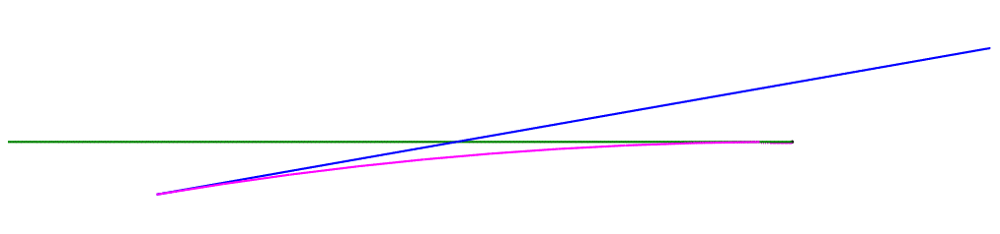
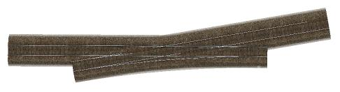
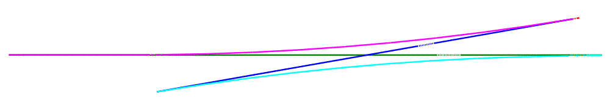
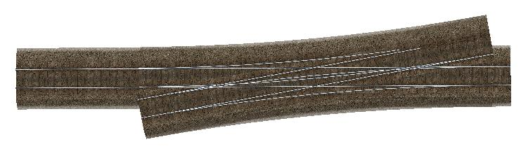
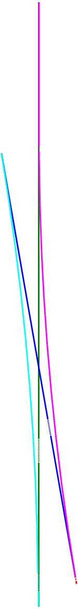

# Track Shape Diagrams with pikchr

[pikchr](https://pikchr.org/home/doc/trunk/homepage.md) is a text-based drawing tool, intended to embed drawings in web pages.
It has a syntax that is somewhat close to MSTS (and Open Rails) track definitions.
Thus it can be used to create drawings of more complex track shapes.

GitHub does not support pikchr. However, there is an [online version](https://pikchr.org/home/pikchrshow) that renders diagram scripts.

## Base Script for Track Shapes

The following is the base script to render track shapes. Paste this into the [website](https://pikchr.org/home/pikchrshow), 
and then add lines and arcs for each segment in the track shape.

```text
# comment this out for a detailed view
scale = 0.2
thickness = 0.1

# straight section: simple, use length from the track section, and position (offset) and angle from the track shape
# Example: SectionIdx ( 1 -2.495 0 30 170 182 )   # section 180 is 17.9123 m long
# line <-> color blue from (-2.495,30) go 17.9123 heading 170

# curved section: Use the arcLine macro.
# - starting point: use the offset (or last.end). The offset must be defined as a label, eg:
#     P: (-2.495,30)
# - starting angle: use the angle from the shape (5th value), or calculate from the preceding piece
#     (eg: if the preceding piece started at 50 degree and was a +10 degree curve, then the new
#     starting angle is 60 degree).
# - radius: from the track section
# - arc angle: from the track section
# - args: line properties, such as arrows (eg: <->) and color (eg: color red)
# Example: SectionIdx ( 1 -2.495 0 30 170 176 )  # section 176 has radius 164.0639 and arc angle 10
# P: (-2.495,30); arcLine( P, 170, 160.0639, 10, color cyan)


# arcLine( startPos, startAngle, radius, arcAngle, args)
define arcLine{
  l = abs(($3) * ($4) * 3.1416 / 180)
  dl = l / 9 ; da = $4 / 10
  line $5 from ($1) go dl heading (($2) + da)
  line $5 from last.end go dl heading (($2) + da * 2)
  line $5 from last.end go dl heading (($2) + da * 3)
  line $5 from last.end go dl heading (($2) + da * 4)
  line $5 from last.end go dl heading (($2) + da * 5)
  line $5 from last.end go dl heading (($2) + da * 6)
  line $5 from last.end go dl heading (($2) + da * 7)
  line $5 from last.end go dl heading (($2) + da * 8)
  arrow $5 from last.end go dl heading (($2) + da * 9)
}
```

Comment out the first two lines to get a more detailed view of the track diagram.

## Example Single Slip Switch A1tSglSlip10d.s TrackShape 77

The following is an augmented shape definition. I added the info (length, or radius and arc) from the referenced TrackSection blocks.

```text
TrackShape ( 77
 FileName ( A1tSglSlip10d.s )
 NumPaths ( 4 )
 MainRoute ( 1 )
 ClearanceDist ( 26 )
 SectionIdx ( 1 0 0 0 0 335 )             length 1.08705
 SectionIdx ( 1 0 0 0 0 179 )             length 40
 SectionIdx ( 1 -2.495 0 30 170 179 )     length 40  offset angled 170
 SectionIdx ( 1 -2.495 0 30 170 176 )     radius 164.0639 arc 10   offset angled 170
 XoverPts ( 1
  XoverPt ( 0 0 15.86433 )
 )
)

```
Next follows the script to render the above shape.
The script is augmented to better illustrate to how the definition translates into a diagram.
In particular:
* In some cases, a slight offset (~0.05) is added to make overlapping sections visible.
* Gaps are filled with extra sections, drawn dashed, to complete the diagram.
* Curves may not exactly line up with other track. _pikchr_ does not support drawing true arcs (radius and sweep-angle).

```text
# comment this out for a detailed view
scale = 0.15
thickness = 0.1

# straight section: simple, use length from the track section, and position (offset) and angle from the track shape
# Example: SectionIdx ( 1 -2.495 0 30 170 182 )   # section 180 is 17.9123 m long
# line <-> color blue from (-2.495,30) go 17.9123 heading 170

# curved section: Use the arcLine macro.
# - starting point: use the offset (or last.end). The offset must be defined as a label, eg:
#     P: (-2.495,30)
# - starting angle: use the angle from the shape (5th value), or calculate from the preceding piece
#     (eg: if the preceding piece started at 50 degree and was a +10 degree curve, then the new
#     starting angle is 60 degree).
# - radius: from the track section
# - arc angle: from the track section
# - args: line properties, such as arrows (eg: <->) and color (eg: color red)
# Example: SectionIdx ( 1 -2.495 0 30 170 176 )  # section 176 has radius 164.0639 and arc angle 10
# P: (-2.495,30); arcLine( P, 170, 160.0639, 10, color cyan)


# arcLine( startPos, startAngle, radius, arcAngle, args)
define arcLine{
  l = abs(($3) * ($4) * 3.1416 / 180)
  dl = l / 9 ; da = $4 / 10
  line $5 from ($1) go dl heading (($2) + da)
  line $5 from last.end go dl heading (($2) + da * 2)
  line $5 from last.end go dl heading (($2) + da * 3)
  line $5 from last.end go dl heading (($2) + da * 4)
  line $5 from last.end go dl heading (($2) + da * 5)
  line $5 from last.end go dl heading (($2) + da * 6)
  line $5 from last.end go dl heading (($2) + da * 7)
  line $5 from last.end go dl heading (($2) + da * 8)
  arrow $5 from last.end go dl heading (($2) + da * 9)
}

### start of shape 78, A1tDblSlip10d.s

dot color black rad 200% at (0,0) 

# 0: SectionIdx ( 1 0 0 0 0 335 ) ; length 1.08705
arrow color magenta from (-0.05,0) go 1.08705 heading 0   # slight offset because of overlap

# missing piece
line <-> dashed color magenta from last.end go 0.42 heading 0

# 1: SectionIdx ( 1 0 0 0 0 179 ) ; length 40
arrow color green from (0,0) go 40 heading 0

# 2: SectionIdx ( 1 -2.495 0 30 170 179 ) ; length 40  offset angled 170
arrow color blue from (-2.495,30) go 40 heading 170

# 3: SectionIdx ( 1 -2.495 0 30 170 176 ) ; radius 164.0639 arc 10 ; offset angled 170
P: (-2.495,30); arcLine( P, 170, 164.0639 , 10, color magenta)

# end of script
```
Next is the diagram rendered. I rotated the image 90 degrees to better fit into this document.



And an image of the actual shape file:



### Commentary

* I only have a basic understanding of the MSTS track definitions (TrackShape and TrackSection in tsection.dat).
  I would have expected a single-slip switch to have 3 paths, not 4.
* There are gaps in the rendering (filled with dashed arrows). 
  These are not a rendering issue (I checked the math).
  I don't know how MSTS deals with these.

## Example Double Slip Switch A1tDblSlip10d.s TrackShape 78

The following is an augmented shape definition. I added the info (length, or radius and arc) from the referenced TrackSection blocks.

```text
TrackShape ( 78
 FileName ( A1tDblSlip10d.s )
 NumPaths ( 9 )
 MainRoute ( 1 )
 ClearanceDist ( 26 )
 SectionIdx ( 1 0 0 0 0 335 )                     0: straight 1.08705
 SectionIdx ( 1 0 0 0 0 187 )                     1: straight 9.56705
 SectionIdx ( 1 2.4565 0 1.9371 -10 187 )         2: straight 9.56705    offset angled -10
 SectionIdx ( 1 2.53 0 1.52 -10 337 )             3: straight 0.21177    offset angled -10
 SectionIdx ( 2 2.4565 0 1.9371 -10 334 333 )     4: curved 160 10 + straight 0.42354    offset angled -10
 SectionIdx ( 1 -2.495 0 30 170 182 )             5: straight 17.9123    offset angled 170
 SectionIdx ( 1 -2.495 0 30 170 176 )             6: curved 164.0639 10  offset angled 170
 SectionIdx ( 1 0 0 40 180 187 )                  7: straight 9.56705    offset angled 180
 SectionIdx ( 1 0 0 40 180 185 )                  8: straight 28.9223    offset angled 180
 XoverPts ( 1
  XoverPt ( 0 0 15.86433 )
 )
)
```

Next follows the script to render the above shape.
The script is augmented to better illustrate to how the definition translates into a diagram.
In particular:
* In some cases, a slight offset (~0.02) is added to make overlapping sections visible.
* Gaps are filled with extra sections, drawn dashed, to complete the diagram.
* Curves may not exactly line up with other track. _pikchr_ does not support drawing true arcs (radius and sweep-angle).

```text
# comment this out for a detailed view
scale = 0.2
thickness = 0.1

# straight section: simple, use length from the track section, and position (offset) and angle from the track shape
# Example: SectionIdx ( 1 -2.495 0 30 170 182 )   # section 180 is 17.9123 m long
# line <-> color blue from (-2.495,30) go 17.9123 heading 170

# curved section: Use the arcLine macro.
# - starting point: use the offset (or last.end). The offset must be defined as a label, eg:
#     P: (-2.495,30)
# - starting angle: use the angle from the shape (5th value), or calculate from the preceding piece
#     (eg: if the preceding piece started at 50 degree and was a +10 degree curve, then the new
#     starting angle is 60 degree).
# - radius: from the track section
# - arc angle: from the track section
# - args: line properties, such as arrows (eg: <->) and color (eg: color red)
# Example: SectionIdx ( 1 -2.495 0 30 170 176 )  # section 176 has radius 164.0639 and arc angle 10
# P: (-2.495,30); arcLine( P, 170, 160.0639, 10, color cyan)


# arcLine( startPos, startAngle, radius, arcAngle, args)
define arcLine{
  l = abs(($3) * ($4) * 3.1416 / 180)
  dl = l / 9 ; da = $4 / 10
  line $5 from ($1) go dl heading (($2) + da)
  line $5 from last.end go dl heading (($2) + da * 2)
  line $5 from last.end go dl heading (($2) + da * 3)
  line $5 from last.end go dl heading (($2) + da * 4)
  line $5 from last.end go dl heading (($2) + da * 5)
  line $5 from last.end go dl heading (($2) + da * 6)
  line $5 from last.end go dl heading (($2) + da * 7)
  line $5 from last.end go dl heading (($2) + da * 8)
  arrow $5 from last.end go dl heading (($2) + da * 9)
}

### start of shape 78, A1tDblSlip10d.s

# logical order (comment shows index of SectionIdx); added missing lines

dot color black rad 200% at (0,0)    # origin marker

# 1: SectionIdx ( 1 0 0 0 0 187 ); length 9.56705
arrow color green from (0,0) go 9.56705 heading 0

# 8: SectionIdx ( 1 0 0 40 180 185 ); length 28.9223
arrow color green from (0,40) go 28.9223 heading 180

# missing piece 
line <-> dashed color green from last.end go 1.51 heading 180

# 2: SectionIdx ( 1 2.4565 0 1.9371 -10 187 ); length 9.56705
arrow color blue from (2.4565,1.9371) go 9.56705 heading -10

# 5: SectionIdx ( 1 -2.495 0 30 170 182 ); length 17.9123
arrow color blue from (-2.495,30) go 17.9123 heading 170

# missing piece 
line <-> dashed color blue from last.end go 1.02 heading 170

# 4: SectionIdx ( 2 2.4565 0 1.9371 -10 334 333 ); radius 160 angle 10; length 0.42354
P: (2.4565,1.9371); arcLine( P, -10, 160, 10, color magenta) ; arrow color magenta from last.end go 0.42354 heading 0

# 7: SectionIdx ( 1 0 0 40 180 187 ); length 9.56705
arrow color magenta from (0.02,40) go 9.56705 heading 180   # slight offset because of overlap

# missing piece 
line <-> dashed color magenta from last.end go 0.3 heading 180

# 6: SectionIdx ( 1 -2.495 0 30 170 176 ); radius 164.0639 angle 10
P: (-2.495,30); arcLine( P, 170, 160.0639, 10, color cyan)

# 0: SectionIdx ( 1 0 0 0 0 335 ); length 1.08705
arrow color cyan from (-0.02,0) go 1.08705 heading 0   # slight offset because of overlap

# missing piece 
line <-> dashed color cyan from last.end go 1.1 heading 0

# 3: SectionIdx ( 1 2.53 0 1.52 -10 337 ); length 0.21177
arrow color red from (2.53,1.52) go 0.21177 heading -10

# missing piece 
line <-> dashed color red from last.end go 0.2 heading -10

# end of script
```
Next is the diagram rendered. I rotated the image 90 degrees to better fit into this document.



And an image of the actual shape file:



Note: I could have rendered the diagram as an SVG, but it would take a lot of space because of the large _pikchr_ canvas size.
```html

```
### Commentary

* I only have a basic understanding of the MSTS track definitions (TrackShape and TrackSection in tsection.dat).
  I would have expected a double-slip switch to have 4 paths, not 9.
* There are gaps in the rendering (filled with dashed arrows). 
  These are not a rendering issue (I checked the math).
  I don't know how MSTS deals with these.


<p align="center" style="color: grey">End of Document</p>
